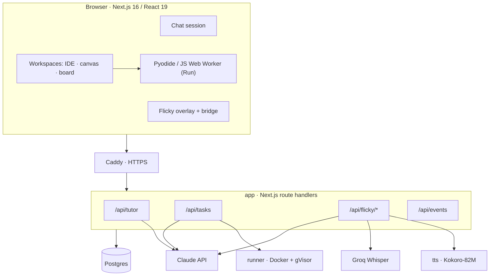
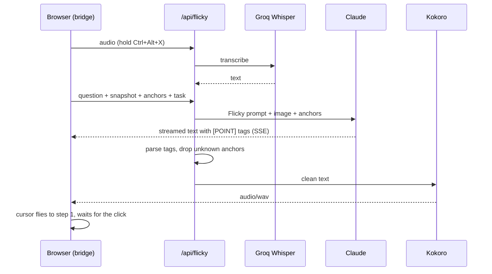

# heforage architecture

Reference for the team and for coding agents. Decisions as of 14 Nov 2026. If code and this file disagree, ask in the team chat and fix whichever is wrong.

## 1. What we are building

An accountant (or any office worker, 25–45, US) wants to switch careers but doesn't know which job they would actually like. heforage lets them try the real work of a junior before paying for any course:

1. Pick a direction and a role: **Programming → Backend engineer**, **Design → UI/Product designer**, **Management → Project manager**. The other six roles in the catalog show "Coming soon".
2. A chat session opens. The mentor interviews them: current job, what they tried, languages, hours per week, goal.
3. The mentor builds a first task for that profile and drops a card into the chat: **Task 1 · Open**.
4. **Open** expands a full-screen workspace: task context on the left, a real tool in the middle (IDE / Figma-like canvas / sprint board), the same chat on the right.
5. Stuck? Hold **Ctrl+Alt+X** and ask out loud. The cursor assistant (Flicky, ported to the web) answers by voice and flies a cursor to the exact place to click, step by step.
6. **Submit** → code decides pass/fail (hidden tests, rule checks), the model explains why. Next card: the same task with a new edge case.
7. After a task in two or three roles, a comparison report: which one they liked, what still stops them, a weekly practice plan. That's where the subscription starts.

Value moment we design for: *"I tried two different jobs and can explain why one fits me better and what I still can't do on my own."*

## 2. Hackathon constraints (Zimran Business Cup 2.0)

- Deadline **15 Nov 2026, 12:00 Astana**. Resubmitting is allowed, the jury sees the last version.
- Submission: pitch deck PDF (≤ 10 slides), **production URL without login**, **public GitHub repo**.
- Scoring: 40% works end-to-end in production with real, not hardcoded core value ("we read your repo"); 20% what we sell and why users return; 15% problem and user; 15% business potential; 10% originality.
- B2C, web only (no mobile, no desktop apps), US adults 25–45. UI language: English.

## 3. Team and zones

| Person | Role | Owns |
|---|---|---|
| **Anuar** (GitHub: alpabruh) | server, infra, AI on the server | `deploy/`, `runner/`, `.github/`, `src/app/api/**`, `src/server/**`, `src/lib/tutor/**`, `src/lib/rate-limit.ts`, `content/tasks/` (format) |
| **Alsheri** | everything the learner sees | `src/app/**` pages and layouts, `src/app/globals.css`, `src/components/**`, `src/lib/flicky/**`, `src/lib/runner.ts`, `src/lib/sessions.ts`, `src/lib/api.ts`, `src/lib/features.ts`, `public/` |
| **Alpamys** | bizdev, task content | seed tasks and rubrics in `content/tasks/` (through Anuar) |
| **Sary** | deck, analytics, business model | the pitch deck (outside the repo) |

**Shared, change only in a small separate PR the other dev reviews:** `src/contracts/**`, `src/lib/catalog.ts`, `src/lib/pay.ts`, `package.json` + `package-lock.json`, `AGENTS.md`, `README.md`, `docs/`.

Personal briefs: [`docs/team/alsheri.md`](team/alsheri.md), [`docs/team/anuar.md`](team/anuar.md).

## 4. System overview

Everything except the language model runs on our own VPS in Docker Compose. Only Caddy is exposed to the internet.



What already works in the repo (built by Alsheri): catalog with 3 directions / 9 roles and BLS pay data, mentor chat on `claude-opus-5-5` with structured output, prompt caching, refusal fallback and a demo mode without a key, Python (Pyodide) and JavaScript tasks running in a network-less Web Worker, paywall with demo checkout ($20 first month, then $35). Sessions live in localStorage.

What we add: interview instead of the quiz, task cards that open full-screen workspaces, design canvas and sprint board, the Flicky assistant, hidden tests and task self-check on the server, Postgres, our own hosting.

## 5. Folder structure

```
heforage/
├─ AGENTS.md                   rules and team zones (shared)
├─ docs/
│  ├─ ARCHITECTURE.md          this file (shared)
│  └─ team/                    personal briefs
├─ deploy/                     [Anuar]   Dockerfile, compose, Caddyfile, Kokoro
├─ runner/                     [Anuar]   code sandbox service, own package.json
├─ content/tasks/              [Anuar + Alpamys] seed tasks, hidden tests, rubrics
├─ third_party/flicky/         MIT license + list of files taken from Flicky
├─ .github/workflows/          [Anuar]   CI (types, lint, build) and deploy
├─ public/                     [Alsheri] static files, Flicky audio worklet
└─ src/
   ├─ contracts/               [shared]  zod schemas + fixtures, the API between zones
   ├─ app/
   │  ├─ page.tsx, s/[slug]/…  [Alsheri] pages
   │  ├─ globals.css           [Alsheri]
   │  └─ api/                  [Anuar]   route handlers
   ├─ server/                  [Anuar]   db, tasks, grading, flicky, metrics
   ├─ components/              [Alsheri]
   │  ├─ session/              chat (exists)
   │  ├─ workspace/            code · design · board
   │  └─ flicky/               ported Flicky UI
   └─ lib/
      ├─ catalog.ts, pay.ts    [shared]  roles and pay data
      ├─ runner.ts             [Alsheri] browser runner (exists)
      ├─ sessions.ts           [Alsheri] client session store (exists)
      ├─ api.ts, features.ts   [Alsheri] typed fetch wrappers, UI feature flags
      ├─ flicky/               [Alsheri] window.flicky bridge, anchors, snapshot
      ├─ tutor/                [Anuar]   mentor prompt, demo mentor, schema
      └─ rate-limit.ts         [Anuar]
```

## 6. Contracts and API

All shapes live in `src/contracts` as zod schemas with inferred types. Fixtures in `src/contracts/fixtures` are valid instances: the API stubs return them, and the UI can be built against them.

| Endpoint | Request → response | Called by | Status |
|---|---|---|---|
| `POST /api/tutor` | chat history → `TutorTurn` | chat | exists; will gain `stage: "interview"` and `task: TaskCard` |
| `GET /api/tasks/:id` | → `PublicTask` | workspace on Open | stub first |
| `POST /api/tasks/:id/submit` | `Submission` → `GradeResult` | Submit button | stub first |
| `POST /api/flicky/transcribe` | multipart `audio` → `TranscribeResponse` | Flicky bridge | stub first |
| `POST /api/flicky/ask` | `AskRequest` → SSE of `AskEvent` | Flicky bridge | stub first |
| `POST /api/flicky/speak` | `SpeakRequest` → `audio/wav` | Flicky bridge | stub first |
| `POST /api/events` | `AppEvent` → 204 | all workspaces | stub first |

The runner is internal (`RUNNER_URL`); the browser never calls it.

Task privacy: `PublicTask` carries the ticket, starter files and visible tests. Hidden tests and the reference solution stay on the server.

## 7. Key flows

**Interview → task card.** `/api/tutor` runs the interview, the model returns a structured profile (level, language, hours, goal). The server picks a seed task for the role, asks the model to personalise the story and edge case, self-checks it in the runner, stores it and returns a `TaskCard` in the turn.

**Run vs Submit.** Run stays in the browser Web Worker with visible tests (instant, no server load). Submit goes to the server: hidden tests in the runner for code, rule checks on the scene JSON for design and on the board JSON for management. `passed` comes only from code checks. The model then writes `explanation` from the check log, and for written parts (status report) adds rubric checks marked `by: "model"`.

**Task self-check.** A generated variant is accepted only if the reference solution passes its tests and the starter code fails them. Two retries, then the seed task is used as is. The learner never gets an unsolvable task.

**Flicky voice hint.**



## 8. Flicky in the browser

[Flicky](https://github.com/pango07/flicky) (MIT) is an Electron clone of Clicky: hold a hotkey, talk, it sees your screen and flies a cursor to what it means. Its React UI only talks to the app through `window.flicky`. We copy the UI and write a web bridge with the same methods.

| Flicky module | In heforage |
|---|---|
| `OverlayApp`, `CursorIcon`, `Waveform`, `StreamApp` | copied into `src/components/flicky` (Alsheri) |
| preload `window.flicky` | rewritten as `src/lib/flicky/bridge.ts` (Alsheri) |
| global hotkey, audio worklet | keydown/keyup in the tab, same worklet via `getUserMedia` (Alsheri) |
| `screen-capture` | JPEG of our page and canvas only, no screen-share prompt (Alsheri) |
| `element-detector` | `parseFlickyAnswer` in `src/contracts/flicky.ts` (shared) |
| `prompts`, `claude-api` | `src/server/flicky` + `/api/flicky/ask` with streaming (Anuar) |
| `transcription` (Groq) | `/api/flicky/transcribe`, Groq Whisper free tier (Anuar) |
| `elevenlabs-tts` | `/api/flicky/speak` → Kokoro-82M on our server, browser `speechSynthesis` as fallback (Anuar) |
| `context-manager` | server-side history + compaction (Anuar) |
| `auto-typer` | insert into our own fields directly; off in code tasks (Alsheri) |
| key store, settings, Ollama/OpenAI | not ported |

**Pointing protocol.** The model gets the workspace image and a list of anchors (`id`, `label`, `role`). It answers with Flicky tags:

```
[POINT:#design.fill.type:open the fill type]     anchor target (preferred, exact at any window size)
[POINT:412,238:this corner:screen0]               Flicky's pixel target in snapshot coordinates (fallback)
[TYPE:text]                                       insert text; disabled in code tasks
```

Anchor ids are lowercase dotted paths without colons: `code.run`, `code.submit`, `code.lines.13-15`, `code.file.handler-py`, `design.layer.<nodeId>`, `design.fill.type`, `design.fill.linear`, `design.radius`, `board.card.<cardId>`, `board.capacity`, `report.field.status`, `report.field.risks`, `report.field.ask`.

**Advancing steps.** Flicky advances on a timer (2.6–5.5 s by caption length, `dwellMs`). In a task we wait for the learner to click the target; the timer is kept for "where is X?" answers. Every shown step is logged as help used. The assistant never gives a full solution: in code it points at lines, names the function or keyword, shows syntax.

**License.** Keep the MIT header in every copied file and list it in `third_party/flicky/README.md`; credits go in the README.

## 9. Voice

- Speech to text: **Groq Whisper** (`whisper-large-v3-turbo`), free tier: 20 requests/min, 2,000/day, 8 h of audio/day, each request billed as at least 10 s. Key only on the server.
- Text to speech: **Kokoro-82M** (Apache 2.0) in its own container on CPU. If one sentence takes longer than ~2 s on the VPS, switch `/api/flicky/speak` to OpenAI TTS (~$15 per 1M characters).
- Fallback for both: browser Web Speech (`speechSynthesis`), so the assistant never goes silent.

## 10. Code sandbox

Run in the browser (exists): Pyodide or a JS Web Worker with network APIs removed, 10 s timeout.

Submit and self-check on the server (`runner/`): a one-off container per attempt, no network, non-root, read-only root, `/tmp` in memory, 1 CPU, 256 MB, 64 processes, 10 s, output ≤ 1 MB, gVisor if available (plain Docker with the same limits otherwise). At most two at a time; a queue table in Postgres.

## 11. Infrastructure

One VPS (Ubuntu 24.04, **at least 4 GB RAM**), domain with an A record to it.

| Service | Image | Public | Purpose |
|---|---|---|---|
| `caddy` | caddy:2 | 80, 443 | HTTPS, proxy, SSE passthrough |
| `app` | ours, Next.js standalone | no | pages, API, Flicky server, grading rules |
| `runner` | ours + python:3.12-slim, node:22-slim | no | hidden tests, self-check |
| `postgres` | postgres:16 | no | data, run queue |
| `tts` | Kokoro-82M | no | speech for Flicky |

CI on every PR: type check, lint, build. Deploy on push to `main`: build images → GHCR → SSH → `docker compose pull && up -d` → health checks. Rollback = previous image tag. Nightly `pg_dump`.

Data tables: `profiles`, `sessions`, `messages`, `tasks` (with private parts), `attempts`, `guide_steps`, `ratings`, `run_queue`.

## 12. How we work without conflicts

- Edit only your zone. Need a change elsewhere: ask the owner or open a small PR they review.
- Contracts first: `src/contracts` is merged before feature work; any contract change is its own small PR.
- Stubs first: Anuar ships every endpoint returning fixtures in the first hour, so Alsheri always calls real URLs.
- Short branches `anuar/*`, `alsheri/*`; PR into `main` every 2–3 hours; rebase on `main` before the PR. `main` must always build: CI checks it.
- New dependency = its own commit, straight to `main`. Lockfile conflict: take `main`'s lockfile and run `npm install`, never hand-merge.
- Unfinished UI hides behind `src/lib/features.ts`; unfinished server features behind env vars. `main` can be deployed at any moment.

**Sync points (Astana time, 10-minute call, both pull `main` and click through the whole flow):**

| Time | Done |
|---|---|
| 22:30 | contracts in `main` |
| 23:30 | stubs for every endpoint in `main` |
| 02:00 | the chat card opens a workspace with a task from `/api/tasks` |
| 05:30 | Submit returns a verdict from the runner's hidden tests |
| 08:30 | Flicky in the browser: voice → tagged answer → cursor over anchors |
| 10:30 | feature freeze, only bugs and polish |

## 13. Cut order if time runs out

1. Voice: questions typed in the chat first, voice last.
2. Sprint board: fall back to the existing written task with rubric grading.
3. Design canvas: select, rectangle, text and fill only.
4. Postgres: sessions stay in localStorage.
5. gVisor: plain Docker with the same limits.

Never cut: production on our VPS without login, interview → task card → full-screen workspace, hidden tests and the code verdict, Flicky at least in the IDE, the public repo with this document.

## 14. Open questions

- VPS and domain: not bought yet.
- Groq account and API key: Anuar.
- Alsheri to confirm his zone.
