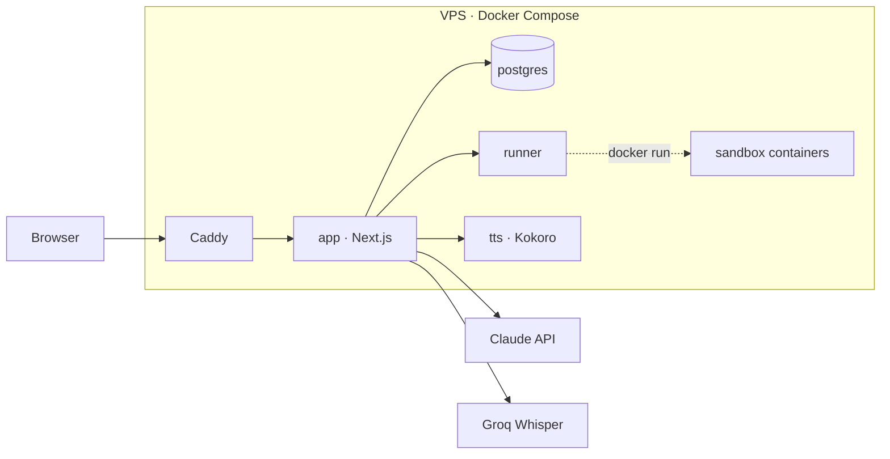
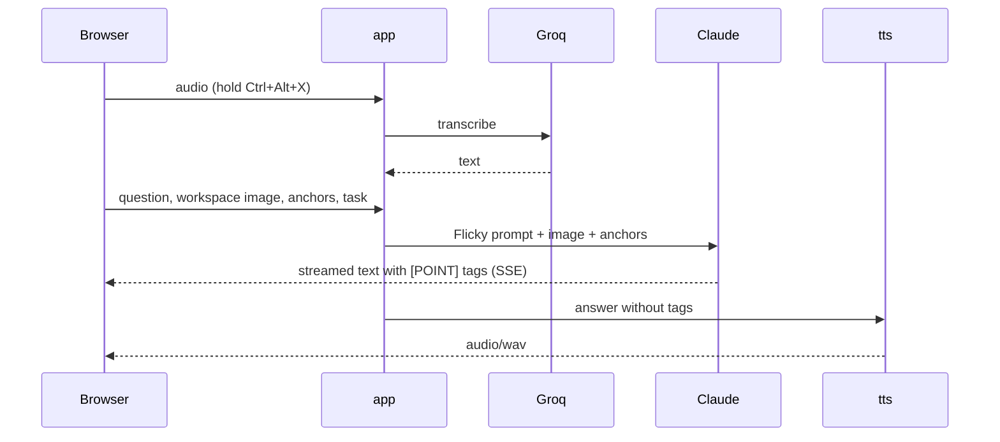

# Architecture

1ry-space lets someone who is thinking about a career switch try the work of a junior in three roles: backend engineer, product designer and project manager. A mentor interviews the learner, hands out a task, and checks the result. Pass/fail is always decided by code; the language model explains results and gives hints. Flicky, a voice assistant ported from [pango07/flicky](https://github.com/pango07/flicky), points at the interface when the learner is stuck.

## Services



| Service | What it does | Network |
|---|---|---|
| `caddy` | HTTPS (Let's Encrypt), reverse proxy, streams SSE unbuffered | public: 80, 443 |
| `app` | Next.js in standalone mode: pages, API routes, grading rules, Flicky server | default + internal |
| `postgres` | profiles, attempts, events | internal only |
| `runner` | runs hidden tests in one-off containers (see below) | internal only |
| `tts` | Kokoro-82M text-to-speech on CPU | internal only |

The internal network has no route to the internet. Only the app talks to the model provider and to Groq.

## API

Request and response shapes are zod schemas in `src/contracts`.

| Route | Contract | Notes |
|---|---|---|
| `POST /api/tutor` | `TutorRequest` → `TutorTurn` | interview, then a `TaskCard` |
| `GET /api/tasks/:id` | → `PublicTask` | ticket, starter files, visible tests; never hidden tests |
| `POST /api/tasks/:id/submit` | `Submission` → `GradeResult` | code: hidden tests in the runner; design and board: rule checks |
| `POST /api/flicky/ask` | `AskRequest` → SSE of `AskEvent` | streamed answer, then the parsed walkthrough |
| `POST /api/flicky/transcribe` | multipart `audio` → `TranscribeResponse` | Groq Whisper |
| `POST /api/flicky/speak` | `SpeakRequest` → `audio/wav` | Kokoro; 503 + `X-Fallback: browser` when unavailable |
| `POST /api/events` | `AppEvent` → 204 | hints, runs, interest ratings |
| `GET /api/health` | → `{ ok, db }` | used by the Docker healthcheck |

Every route works without external keys: the mentor falls back to a scripted demo, Flicky to a recorded answer, speech-to-text to a fixed question. The response says which mode answered (`mode` in `/api/tutor`, `X-Flicky-Mode` header in Flicky routes).

## Flows

**Interview → task.** For the MVP roles the mentor asks four questions (current job and experience, tools, hours a week, goal). The turn that ends the interview carries a `profile`; the server picks the role's seed task and attaches its `TaskCard`. The model never chooses task ids.

**Run vs Submit.** *Run* executes the learner's code in a browser Web Worker (Pyodide or a network-less JS worker) against the visible tests. *Submit* goes to the server: hidden tests in the runner for code, rule checks on the scene JSON for design and on the board JSON for management. `passed` is computed from these checks only; the explanation is text around them.

**Flicky.**



The model points at UI elements with Flicky's tag format. Anchor targets come first; pixel targets in image coordinates are the fallback:

```
[POINT:#design.fill.type:open the fill type]
[POINT:412,238:this corner:screen0]
```

Anchor ids are dotted paths without colons (`code.run`, `code.lines.13-15`, `design.layer.<id>`, `board.card.<id>`). `parseFlickyAnswer` drops steps whose anchor the page did not register, so the cursor never targets a missing element.

## Data

Learners are anonymous: the first API call sets an httpOnly cookie `uid` with a random UUID. Migrations live in `src/server/db/migrations.ts` and run on the first query under an advisory lock.

| Table | Written by |
|---|---|
| `users` | any write |
| `profiles` | `/api/tutor`, once per learner and role |
| `attempts` | `/api/tasks/:id/submit` |
| `events` | `/api/events` |

Writes are best-effort: if Postgres is unavailable the request still succeeds and the skipped write is logged.

## Code sandbox

Each submission runs in its own container started by the runner with `docker run --rm`:

| | |
|---|---|
| network | none |
| filesystem | read-only root, 64 MB `/tmp` in memory |
| user | 65534, all capabilities dropped, `no-new-privileges` |
| resources | 1 CPU, 256 MB, 64 processes, 10 s, 1 MB of output |
| runtime | gVisor when the host has `runsc`, otherwise runc |
| concurrency | 2 at a time, 20 queued |

The runner needs the host's Docker socket, which is root-equivalent. It is therefore reachable only from the app, has no internet access and only ever runs fixed images with fixed flags; learner code is passed on stdin.

## Running it

- `npm run dev` runs the app alone. Without `DATABASE_URL`, `RUNNER_URL` and `TTS_URL` it uses the fallbacks above.
- `docker compose -f deploy/docker-compose.yml up -d --build` runs the full stack; see `deploy/README.md`.

## Decisions

- **Self-hosted.** One VPS with Docker Compose instead of a serverless platform: the sandbox needs to start containers, voice synthesis needs a long-running CPU process, and Flicky streams for minutes.
- **Grading by code.** Hidden tests and rule checks decide `passed`; the model never overrides them.
- **Anchors over pixels.** Flicky originally points with screenshot coordinates. Our workspaces register anchors, which stay correct at any window size and can be validated.
- **Kokoro instead of ElevenLabs.** Open weights (Apache 2.0), no per-character cost, about 0.4–1.6 s per answer on CPU in local tests.
